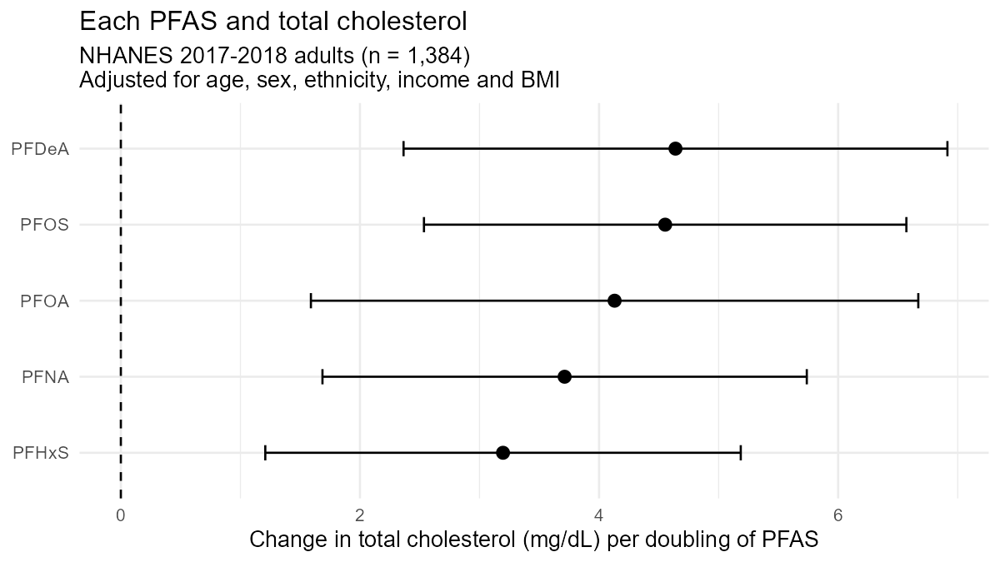
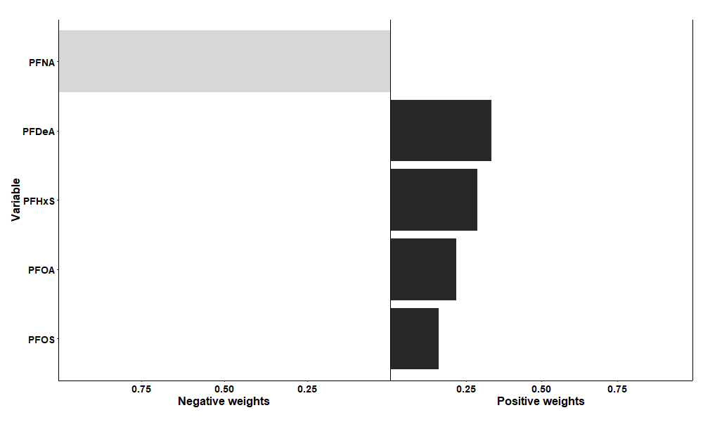

# PFAS mixtures and total cholesterol in US adults

A small, reproducible analysis of how a **mixture of PFAS chemicals in blood** relates to **total cholesterol**, using public NHANES 2017–2018 data in R. I built it to learn exposure-mixture methods used in exposome research.

**Main result:** increasing all five PFAS together by one quartile was associated with **7.7 mg/dL higher total cholesterol** (95% CI 4.7–10.7). PFDeA and PFHxS contributed most to this effect.

## Question

Is the mixture of PFAS in blood associated with total cholesterol in US adults, and which PFAS contribute most?

## Data

- **Source:** [NHANES 2017–2018](https://wwwn.cdc.gov/nchs/nhanes/continuousnhanes/default.aspx?BeginYear=2017), a public US health survey.
- **Files:** serum PFAS (`PFAS_J`), demographics (`DEMO_J`), total cholesterol (`TCHOL_J`) and body measures (`BMX_J`), linked by participant ID (`SEQN`).
- **Exposures:** five PFAS (ng/mL): PFOA (linear + branched), PFOS (linear + branched), PFHxS, PFNA and PFDeA. PFUnDA and Me-PFOSA-AcOH were not used because many values were below the detection limit.
- **Outcome:** total cholesterol (mg/dL).
- **Covariates:** age, sex, ethnicity, income-to-poverty ratio and BMI.
- **Sample:** adults aged 20+ with complete data, **n = 1,384**. Median PFOS was 5.0 ng/mL and median PFOA 1.4 ng/mL. PFAS levels were right-skewed and moderately correlated with each other (r = 0.16–0.69).

## Methods

1. **Single-chemical models:** linear regression of cholesterol on log-transformed PFAS, one chemical at a time, adjusted for all covariates. P-values were corrected for testing five chemicals (Benjamini–Hochberg FDR).
2. **Mixture model:** quantile g-computation (`qgcomp`), which splits each PFAS into quartiles and estimates the joint effect of increasing all of them by one quartile, plus each chemical's weight in that effect.

## Results

**Single-chemical models.** All five PFAS were positively associated with cholesterol (all FDR-adjusted p < 0.01). Per doubling of PFAS, cholesterol was about 3–5 mg/dL higher (for example, about 4.5 mg/dL for PFOS).

| PFAS | Estimate per log-unit (mg/dL) | 95% CI | FDR p |
|---|---|---|---|
| PFOA | 5.96 | 2.29 – 9.62 | 0.002 |
| PFOS | 6.57 | 3.66 – 9.48 | < 0.001 |
| PFHxS | 4.61 | 1.74 – 7.48 | 0.002 |
| PFNA | 5.36 | 2.43 – 8.28 | < 0.001 |
| PFDeA | 6.69 | 3.41 – 9.97 | < 0.001 |

**Mixture model.** Increasing all five PFAS by one quartile was associated with **7.7 mg/dL higher cholesterol** (95% CI 4.7–10.7; p < 0.001).

| Direction | PFAS weights |
|---|---|
| Positive (sum of coefficients 9.45) | PFDeA 0.33 · PFHxS 0.29 · PFOA 0.22 · PFOS 0.16 |
| Negative (sum of coefficients −1.75) | PFNA 1.00 |

**What this shows.** PFNA was positively associated with cholesterol on its own but received a small negative weight in the mixture model. PFNA is strongly correlated with PFDeA (r = 0.69) and PFOS (r = 0.58), so its single-chemical association may partly reflect those exposures. This is the reason to analyse correlated exposures as a mixture. Weights are not tests of significance, so the small negative PFNA weight should be read with caution.

## Limitations

- Cross-sectional data, so the results show associations, not cause and effect.
- NHANES survey weights and design were not used, so the estimates describe this sample rather than the whole US population.
- Values below the detection limit were imputed by NHANES (LOD/√2).
- Cholesterol-lowering medication was not accounted for.
- The mixture model assumes a linear, additive effect across quartiles.

## How to run

1. Install R and RStudio.
2. Download the four `.xpt` files listed in `analysis.R` into a folder called `data`.
3. Run `analysis.R`. Figures are saved to `figures/`.

Packages: tidyverse, haven, broom, qgcomp.

## Author

Andleeb Zahra · MS Biochemistry and Molecular Biology, COMSATS University Islamabad · [ORCID 0009-0000-5999-188X](https://orcid.org/0009-0000-5999-188X)
